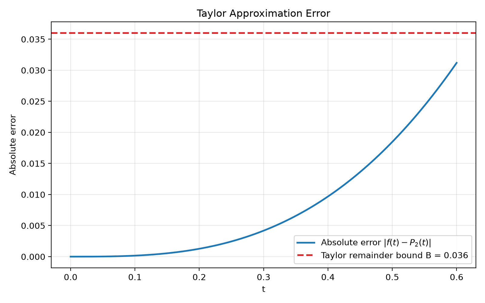
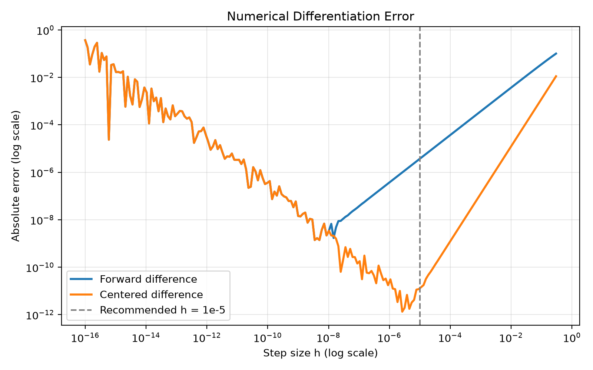
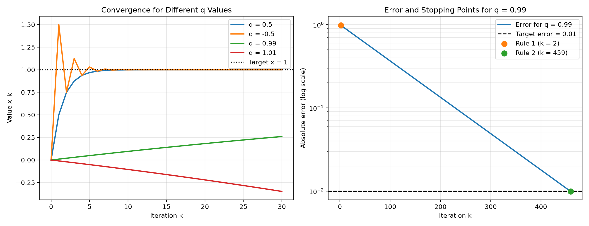

# Numerical Methods in Python

A collection of Python programs exploring numerical approximation, differentiation, iterative convergence, and linear systems. Each program applies mathematical methods to solve computational problems, evaluate accuracy, and visualize results.

## 1. Taylor Approximation and Error Analysis

**Program:** `taylor_approx_error.py`

### Problem
How accurately can a quadratic polynomial approximate exponential decay?

We approximate the function:

$$
f(t)=e^{-t}
$$

using its second-order Taylor polynomial:

$$
P_2(t)=1-t+\frac{t^2}{2}
$$

The program evaluates the absolute approximation error at 601 points over $[0,0.6]$ and compares the results against the theoretical error bound:

$$
|f(t)-P_2(t)|\leq \frac{0.6^3}{6}=0.036
$$

**Result:** The maximum sampled error is approximately **0.03118836** at $t=0.6$, remaining below the theoretical bound of 0.036.



---

## 2. Numerical Differentiation and Floating-Point Accuracy

**Program:** `numerical_differentiation.py`

### Problem
How does step size affect the accuracy of numerical derivative estimates?

We estimate the derivative of $f(t)=e^{-t}$ at $t=0.3$ using two numerical methods.

**Forward Difference:**

$$
D_F(h)=\frac{f(t+h)-f(t)}{h}
$$

**Centered Difference:**

$$
D_C(h)=\frac{f(t+h)-f(t-h)}{2h}
$$

The program calculates both estimates over logarithmically spaced step sizes and compares their absolute errors against the analytical derivative.

**Result:** Centered differences generally achieve higher accuracy due to their second-order truncation error. Extremely small step sizes introduce floating-point cancellation errors, demonstrating that smaller steps do not always produce better estimates.

A practical choice is the centered difference with $h=10^{-5}$.



---

## 3. Iterative Convergence and Stopping Criteria

**Program:** `convergence.py`

### Problem
How can we determine whether an iterative computation converges and when it should stop?

We investigate the recurrence relation:

$$
x_{k+1}=qx_k+(1-q)
$$

with initial condition $x_0=0$ and parameters:

$$
q\in\{0.5,-0.5,0.99,1.01\}
$$

The corresponding explicit solution is:

$$
x_k=1-q^k
$$

The program examines convergence behavior and compares two stopping thresholds based on successive changes:

$$
\Delta_k=|x_k-x_{k-1}|
$$

For $q=0.99$, the relationship between error and successive change is:

$$
e_k=99\Delta_k
$$

**Result:** A stopping threshold of 0.01 terminates prematurely at iteration 2. A mathematically justified threshold of $0.01/99$ stops at iteration 459 and guarantees an error below 0.01.



---

## 4. Linear Systems and Feasibility Analysis

**Program:** `linear_systems.py`

### Problem
Can target sensor readings be achieved using nonnegative quantities of three components?

We solve a linear system:

$$
A\mathbf{x}=\mathbf{b}
$$

where:

$$
A=
\begin{bmatrix}
0 & 1 & 1\\
1 & 1 & 0\\
1 & 0 & 1
\end{bmatrix}
$$

The program uses NumPy's linear-system solver to determine component quantities and verifies each solution using the residual:

$$
\mathbf{r}=A\mathbf{x}-\mathbf{b}
$$

A solution is considered feasible when all component quantities are nonnegative.

### Results

| Target Readings | Solution | Feasible |
|---|---|---|
| (1, 1, 3) | (1.5, -0.5, 1.5) | No |
| (1, 1, 2) | (1, 0, 1) | Yes |

The original target requires a negative component quantity, while the modified target produces a feasible solution.

---

## Running the Programs

**Language:** Python 3

**Libraries:** NumPy, Matplotlib

Install dependencies:

```bash
python3 -m pip install numpy matplotlib
```

Run each program:

```bash
python3 taylor_approx_error.py
python3 numerical_differentiation.py
python3 convergence.py
python3 linear_systems.py
```

Each program prints its numerical results to the terminal. Programs that generate visualizations automatically save their graphs to the `figures/` directory.

---

**Author:** Aditya Gundimeda

**Technologies:** Python · NumPy · Matplotlib
