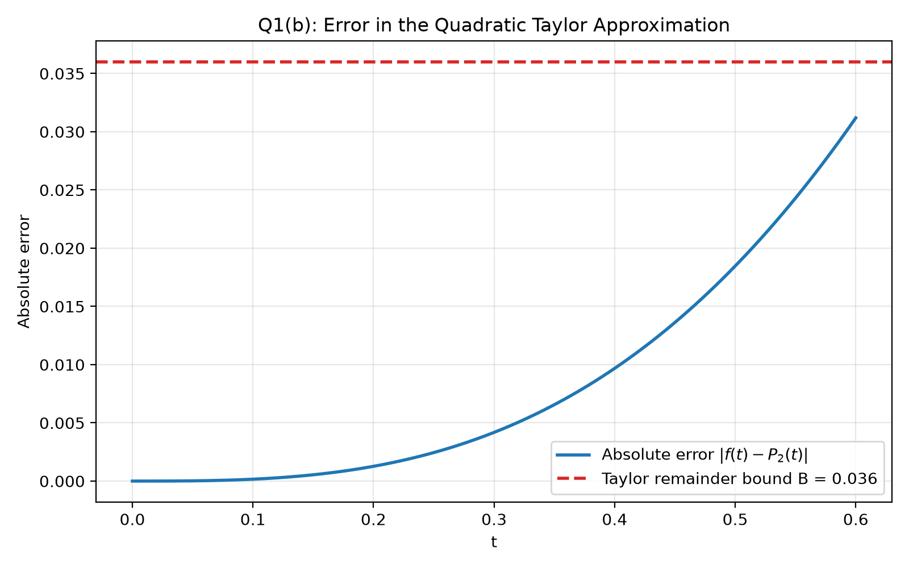
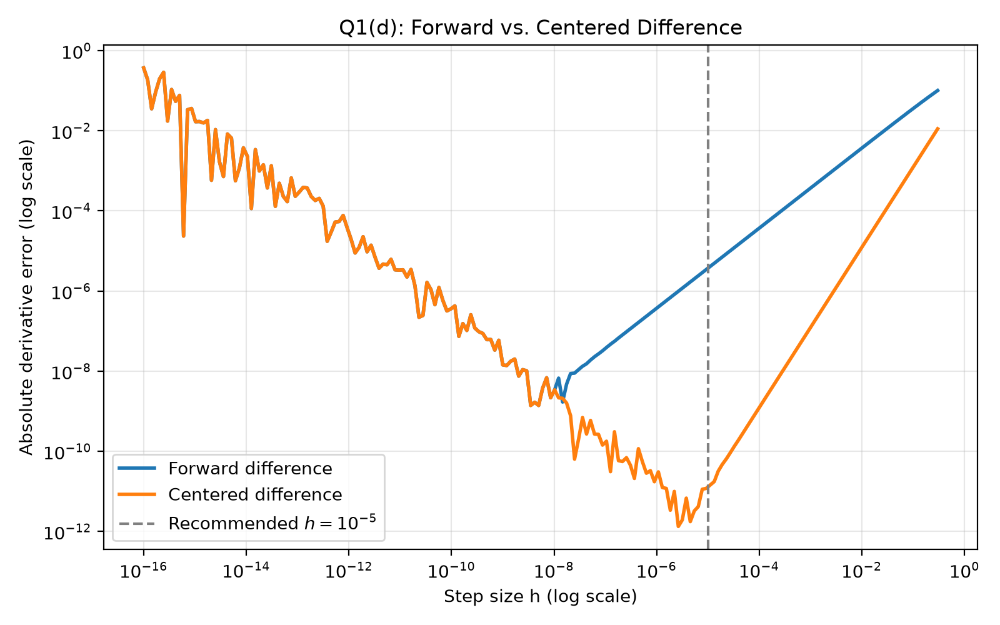
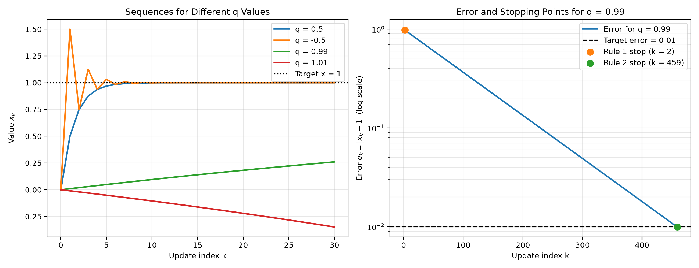

# Numerical Methods in Python

A collection of Python programs exploring numerical approximation, differentiation, iterative convergence, and linear systems. Each program applies mathematical methods to solve a computational problem, analyze accuracy, and visualize results.

## 1. Taylor Approximation Error
**File:** `taylor_approx_error.py`

**Problem:** How accurately can a quadratic polynomial approximate exponential decay?

We approximate the function

$$f(t)=e^{-t}$$

using its second-order Taylor polynomial:

$$P_2(t)=1-t+\frac{t^2}{2}$$

The program evaluates the absolute approximation error across 601 sample points over $[0,0.6]$ and compares the results against the theoretical error bound.

**Result:** Maximum sampled error ≈ 0.03118836 at $t=0.6$, below the theoretical bound of 0.036.

## 2. Numerical Differentiation
**File:** `numerical_differentiation.py`

**Problem:** How does step size affect the accuracy of numerical derivative estimates?

We estimate the derivative of $f(t)=e^{-t}$ at $t=0.3$ using two methods:

- **Forward difference:** $[f(t+h)-f(t)]/h$
- **Centered difference:** $[f(t+h)-f(t-h)]/(2h)$

The program compares numerical estimates against the analytical derivative over logarithmically spaced step sizes.

**Result:** Centered differences generally achieve better accuracy, although extremely small step sizes introduce floating-point cancellation errors. A practical choice is $h=10^{-5}$.

## 3. Iterative Convergence and Stopping Criteria
**File:** `convergence.py`

**Problem:** How can we determine whether an iterative computation converges and when it should stop?

We investigate the recurrence:

$$x_{k+1}=qx_k+(1-q)$$

for four values of $q$: 0.5, −0.5, 0.99, and 1.01.

The program examines convergence behavior and compares two stopping thresholds using the changes between successive iterations.

**Result:** For $q=0.99$, a threshold of 0.01 stops prematurely at iteration 2. A mathematically justified threshold of $0.01/99$ stops at iteration 459 and guarantees an error below 0.01.

## 4. Linear Systems and Feasibility
**File:** `linear_systems.py`

**Problem:** Can target sensor readings be achieved using nonnegative quantities of three components?

We solve the matrix equation

$$A\mathbf{x}=\mathbf{b}$$

using NumPy's linear-system solver, then calculate the residual vector to verify accuracy and check whether each solution is physically feasible.

**Results:**

| Target readings | Solution | Feasible? |
|---|---|---|
| (1, 1, 3) | (1.5, −0.5, 1.5) | No |
| (1, 1, 2) | (1, 0, 1) | Yes |

The original target requires a negative component quantity, while the modified target has a feasible solution.

---

## Running the Programs

**Requirements:** Python 3, NumPy, Matplotlib

Install the required packages:

`python3 -m pip install numpy matplotlib`

Run each program from the project directory:

- `python3 taylor_approx_error.py`
- `python3 numerical_differentiation.py`
- `python3 convergence.py`
- `python3 linear_systems.py`

Each program prints its numerical results to the terminal. Programs that generate graphs automatically save them in the `figures/` directory.

---

**Author:** Aditya Gundimeda  
**Technologies:** Python · NumPy · Matplotlib